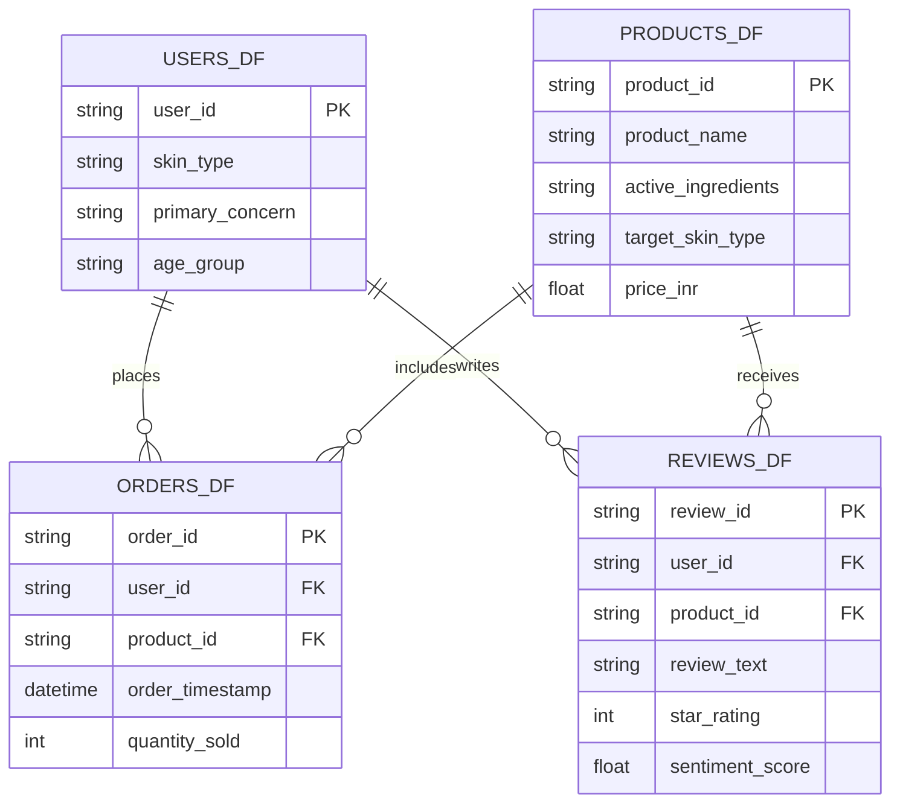

# AI-Driven Personalization & Retention System: Beauty & Wellness Data Science


## Project Overview

This repository contains the **Week 1 Project Deliverable** for the **Data Science with Python Analyst Internship** (Coimbatore Hub). The project focuses on **Data Science Orientation & Problem Definition in the Beauty & Wellness Sector**.

### Problem Statement
> **"How can a Direct-to-Consumer (D2C) Beauty & Wellness platform leverage customer demographic profiles, skin metadata, transactional interaction logs, and unstructured review sentiment to build an automated AI Recommendation Engine and Predictive Churn Alert System that increases 60-day repeat purchase rates by 20% and reduces product return friction?"**

---

## Key Project Deliverables

- 📄 **Word Document Report**: [`Data_Science_Orientation_Beauty_Wellness_Week1.docx`](./Data_Science_Orientation_Beauty_Wellness_Week1.docx)
- 🐍 **Document Generator Script**: [`generate_doc.py`](./generate_doc.py)
- 📋 **Dependencies Specification**: [`requirements.txt`](./requirements.txt)

---

## Business Rationale & ROI Matrix

| Business Friction Point | Data Science Solution & Technique | Quantifiable Business ROI |
| :--- | :--- | :--- |
| **High 30-Day Customer Churn** (65-70% industry average) | Predictive Churn Classification (Logistic Regression / XGBoost) using 14-day engagement signals | 15–22% Reduction in 60-Day Churn; estimated $150,000+ annual savings in retention ad spend. |
| **Generic Recommendations** leading to low Average Order Value (AOV) | Hybrid Recommendation Engine (Content Ingredient Matching + SVD Collaborative Filtering) | 20–25% Boost in Average Order Value (AOV) via personalized cross-selling. |
| **Adverse Reactions in Reviews** | Aspect-Based NLP Sentiment Extraction (VADER / TF-IDF N-gram Mining) | Early detection of defective product batches and a 30% drop in negative brand sentiment. |
| **High Return Rates** due to Skin Incompatibility | Dermatological Ingredient-Skin Alignment Matrix Rules | 25–30% Decrease in product return volume and customer service ticket costs. |

---

## Research Questions & Hypotheses Framework

### Research Questions (RQs)
- **RQ1 (Exploratory)**: Which specific skin profile attributes (e.g., skin type, acne severity) exhibit the strongest statistical correlation with positive 5-star ratings and repeat purchase behavior?
- **RQ2 (Methodological)**: Does incorporating NLP-derived review sentiment scores into collaborative filtering matrices improve recommendation precision ($NDCG@5$) compared to standard star ratings alone?
- **RQ3 (Predictive)**: Can customer interaction signals within the first 14 days post-onboarding predict 60-day customer churn with $>80\%$ ROC-AUC accuracy?

### Hypotheses (H1–H3)
1. **H1 (Skin-Ingredient Alignment)**: Customers receiving product recommendations matched to their skin concerns will demonstrate a significantly higher 60-day repeat purchase rate ($\chi^2$ test, $\alpha = 0.05$).
2. **H2 (NLP Sentiment Enrichment)**: Incorporating aspect sentiment scores into the item representation matrix significantly increases Recommendation Precision@5 compared to pure collaborative filtering (Paired t-Test, $p < 0.05$).
3. **H3 (Predictive Churn Trigger)**: Low 14-day engagement activity combined with negative initial review sentiment serves as a primary predictor of 60-day customer churn ($ROC-AUC > 0.80$).

---

## Relational Data Architecture



---

## Python Ecosystem & Toolstack

- **Data Wrangling & Matrix Math**: `pandas`, `numpy`
- **Machine Learning & Preprocessing**: `scikit-learn`
- **Natural Language Processing**: `nltk`, `spacy`, `textblob`
- **Recommender Systems**: `scikit-surprise`
- **Data Visualization**: `matplotlib`, `seaborn`
- **Document Automation**: `python-docx`

---

## How to Run locally & Generate `.docx` Deliverable

1. **Clone the repository**:
   ```bash
   git clone https://github.com/RENUKANAGARAJANP/beauty-wellness-data-science-week1.git
   cd beauty-wellness-data-science-week1
   ```

2. **Install requirements**:
   ```bash
   pip install -r requirements.txt
   ```

3. **Execute Document Generator**:
   ```bash
   python generate_doc.py
   ```

---

## License & Compliance
This project complies with India's **Digital Personal Data Protection (DPDP) Act 2023** and GDPR guidelines for anonymized consumer data processing.
